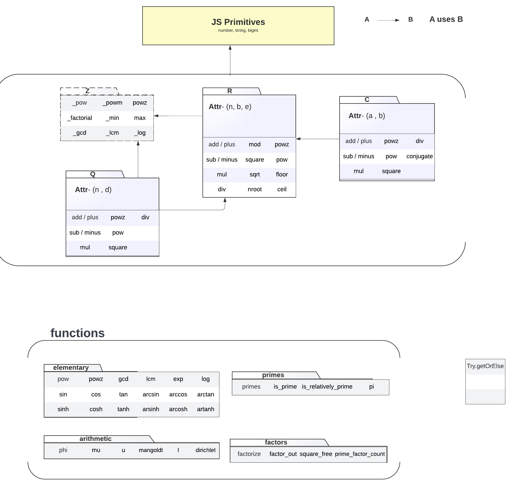

<!-- <style>
  .title {
    font-size: 72px;
    font-weight: 900;
  }

  .title-name {
    background: -webkit-linear-gradient(45deg, #00ff36, #003aff);
    -webkit-background-clip: text;
    -webkit-text-fill-color: transparent;
  }

  .title-initial {
    color: #07ba44 !important;
  }

  .title-ext {
    color: #ff5050 !important;
  }
</style>

<h1 class = "title">
  <span class="title-initial">r</span><span class="title-name">math</span><span class="title-ext">js</span>
  v2
</h1> -->


An advanced, high-precision mathematics library for JavaScript and TypeScript. `@rmath/rmathjs` provides comprehensive support for arbitrary-precision decimals, real numbers, fractions, and complex numbers, along with an extensive collection of arithmetic operations and transcendental functions.

## Architecture


## Installation


```bash
npm install @rmath/rmathjs

```

---

## Configuration

To customize or initialize library configurations (such as global precision settings), import the configuration object:

```javascript
import { config } from "@rmath/rmathjs";

// Config Options
export type ConfigType = {
  precision : number,
  base : number
  string : "string" | "object"
}
```

---

## Initialization & Data Types

The library natively supports four core numerical types: `decimal`, `real`, `fraction`, and `complex`. These can be instantiated using numbers, strings, or BigInts.

### Decimals & Real Numbers

```javascript
import { decimal, real } from "@rmath/rmathjs";

// Initialize from a string
var n = decimal("121");
console.log(n.toString()); 
// Output: 121

// Initialize as a real number
var n = real("121");
console.log(n.toString()); 
// Output: 121

// Initialize from a standard floating-point number
var n = decimal(12134.121);
console.log(n.toString()); 
// Output: 12134.121

// Initialize an arbitrary-precision large decimal string
var n = decimal("1213212012910920131209381023809128091300128309192931.1212839182312931820391");
console.log(n.toString()); 
// Output: 1213212012910920131209381023809128091300128309192931.1212839182312931820391

// Initialize from a BigInt
var n = decimal(12134n);
console.log(n.toString()); 
// Output: 12134

// Initialize from scientific notation
var n = decimal(1.2134121e4);
console.log(n.toString()); 
// Output: 12134.121

```

### Fractions

Accepts either a single string of the form `"r/q"`, or two separate parameters `fraction(a, b)` where parameters are integers, BigInts, strings, or rational objects. `b` must not be null or undefined.

```javascript
import { fraction } from "@rmath/rmathjs";

// Initialize from a single fraction string
var f = fraction("1213/1231231");
console.log(f.toString()); 
// Output: 1213/1231231

// Initialize from numerator and denominator integers
var f = fraction(1213, 1231231);
console.log(f.toString()); 
// Output: 1213/1231231

// Initialize from fraction string arguments (simplifies automatically)
var f = fraction("3/12", "3/4");
console.log(f.toString()); 
// Output: 1/4

```

### Complex Numbers

Accepts a single string formatted as `"a+ib"`, or separate real and imaginary components.

```javascript
import { complex } from "@rmath/rmathjs";

// Initialize from a single complex number string
var c = complex("1+2i");
console.log(c.toString()); 
// Output: 1+2i

// Initialize from distinct real and imaginary components
var c = complex("1", 2);
console.log(c.toString()); 
// Output: 1+2i

```

---

## Basic Operations

The primary numerical objects expose instance methods to perform high-precision arithmetic operations.

```javascript
import { real } from "@rmath/rmathjs";

let a = real("12121210901921.912091201");
let b = 1212918212918291892189281n;

// Addition
var r = a.add(b);
console.log(r.toString()); 
// Output: 1212918212930413103091202.912091201

// Subtraction
var r = a.sub(b);
console.log(r.toString()); 
// Output: -1212918212906170681287359.087908799

// Multiplication
var r = a.mul(b);
console.log(r.toString()); 
// Output: 14702037465564842672031911863800000000

// Division
var r = a.div(b);
console.log(r.toString()); 
// Output: 0.000000000009993428058729674783457430491

// Additive Inverse (-a)
var r = a.addinv();
console.log(r.toString()); 
// Output: -12121210901921.912091201

// Multiplicative Inverse (1/a)
var r = a.mulinv();
console.log(r.toString()); 
// Output: 0.00000000000008250000829879482

// Modulo / Remainder
var r = real(b).mod(a);
console.log(r.toString()); 
// Output: 6284415173512.910290169

// Integer Verification (Checks if number is an integer)
var r = a.isInteger();
console.log(r.toString()); 
// Output: false

var r = real(1212891381938198319839183).isInteger();
console.log(r.toString()); 
// Output: true

```

---

## Mathematical Functions

All core functions are precision-optimized and support huge numbers, decimals, fractions, or complex numbers.

### `gcd`

Computes the greatest common divisor of two large integers.

```javascript
import { gcd } from "@rmath/rmathjs";
var r = gcd(12121323232, 1212903239029012309182903810283190312n);
console.log(r.toString()); 
// Output: 8

```

### `factorial`

Calculates the factorial of a given integer.

```javascript
import { factorial } from "@rmath/rmathjs";
var r = factorial(112);
console.log(r.toString()); 
// Output: 197450685722107402353682037275992488341277868034975337796656295094902858969771811440894224355027779366597957338237853638272334919686385621811850780464277094400000000000000000000000000

```

### `pow`

Performs modular exponentiation efficiently on integers.

```javascript
import { pow } from "@rmath/rmathjs";
var r = pow(233, 13232, 1000000);
console.log(r.toString()); 
// Output: 799361

```

### `powz`

Computes number raised to integer power.

```javascript
import { powz } from "@rmath/rmathjs";
var r = powz(121, 10);
console.log(r.toString()); 
// Output: 672749994932560009201

var r = powz("1 + 2i", 2);
console.log(r.toString()); 
// Output: -3+4i

```

### `exp`

Calculates the exponential function of a value.

```javascript
import { exp } from "@rmath/rmathjs";
var r = exp(10);
console.log(r.toString()); 
// Output: 22026.4657948067165169579006449

var r = exp(1.71);
console.log(r.toString()); 
// Output: 5.52896147762400405587885235146

```

### `log`

Computes logarithm of number to specified base.

```javascript
import { log } from "@rmath/rmathjs";
var r = log(1000, 10);
console.log(r.toString()); 
// Output: 2.99999999999999999999999970088

var r = log(1500, 12);
console.log(r.toString()); 
// Output: 2.94305638713399091876584804139

```

### `ln`

Returns natural logarithm of a given value.

```javascript
import { ln } from "@rmath/rmathjs";
var r = ln(1000);
console.log(r.toString()); 
// Output: 6.907755278982137052053973675304

```

### `sin`

Computes the sine of an angle in radians.

```javascript
import { sin } from "@rmath/rmathjs";
var r = sin(1.50);
console.log(r.toString()); 
// Output: 0.997494986604054430941723371142

```

### `cos`

Computes the cosine of an angle in radians.

```javascript
import { cos } from "@rmath/rmathjs";
var r = cos(1.50);
console.log(r.toString()); 
// Output: 0.070737201667702910088189851434

```

### `tan`

Computes the tangent of an angle in radians.

```javascript
import { tan } from "@rmath/rmathjs";
var r = tan(1.50);
console.log(r.toString()); 
// Output: 14.101419947171719387646083652

```

### `arcsin`

Computes arcsine value; requires domain constraint input properties.

```javascript
import { arcsin } from "@rmath/rmathjs";
var r = arcsin(.10);
console.log(r.toString()); 
// Output: 0.100167421199311755952380952381

```

> *Note: Only accepts real input domain within `[-1, 1]` to output real numbers.*

### `arccos`

Computes arccosine value; requires domain constraint input properties.

```javascript
import { arccos } from "@rmath/rmathjs";
var r = arccos(.10);
console.log(r.toString()); 
// Output: 1.4706289055955848632789407392

```

> *Note: Only accepts real input domain within `[-1, 1]` to output real numbers.*

### `arctan`

Computes the arctangent of a given number.

```javascript
import { arctan } from "@rmath/rmathjs";
var r = arctan(.10);
console.log(r.toString()); 
// Output: 0.099668652491162027378446119878

```

### `sinh`

Computes hyperbolic sine of a given number.

```javascript
import { sinh } from "@rmath/rmathjs";
var r = sinh(1.50);
console.log(r.toString()); 
// Output: 2.12927945509481749683438749467

```

### `cosh`

Computes hyperbolic cosine of a given number.

```javascript
import { cosh } from "@rmath/rmathjs";
var r = cosh(1.50);
console.log(r.toString()); 
// Output: 2.35240961524324732576766796544

```

### `tanh`

Computes hyperbolic tangent of a given number.

```javascript
import { tanh } from "@rmath/rmathjs";
var r = tanh(1.50);
console.log(r.toString()); 
// Output: 0.905148253644866438242303696456

```

### `arcsinh`

Computes inverse hyperbolic sine of a number.

```javascript
import { arcsinh } from "@rmath/rmathjs";
var r = arcsinh(1.50);
console.log(r.toString()); 
// Output: 1.194763217287109304111930829597

```

### `arccosh`

Computes inverse hyperbolic cosine; requires domain constraint input properties.

```javascript
import { arccosh } from "@rmath/rmathjs";
var r = arccosh(1.50);
console.log(r.toString()); 
// Output: 0.96242365011920689499551782761

```

> *Note: Only accepts real input domain `x >= 1` to output real numbers.*

### `arctanh`

Computes inverse hyperbolic tangent; requires domain constraint input properties.

```javascript
import { arctanh } from "@rmath/rmathjs";
var r = arctanh(0.10);
console.log(r.toString()); 
// Output: 0.100335347731075580635726552489

```

> *Note: Only accepts real input domain within `(-1, 1)` to output real numbers.*


# Convections
## Naming Convections
1. Class / Interface / types should be in CapitalCammelCase.
2. Variable name should be in flatcase / snake_case
3. Constants should be in UPPER_CASE.

# Motivation
Motivation is to create libary able to do any mathematical task in js efficiently.

# Mentions
Below software / tools helped **rmathjs** to get is struture.
1. Regex helper -> https://regex101.com/r
2. decimal.js -> https://github.com/MikeMcl/decimal.js/

---

## Benchmark

`@rmath/rmathjs` includes dual computational backends:
1. **WebAssembly (`rmathrs`)**: High-performance arbitrary-precision mathematical engine compiled from Rust using Malachite.
2. **Pure JavaScript (No-WASM)**: Fallback numerical algorithms implemented in native TypeScript/JavaScript.

The benchmark suite evaluates both engines side-by-side on the exact same inputs and operations over **1,000 evaluations** at various decimal precisions (30, 50, and 100 digits).

### Performance Results Table

*Evaluated over **1,000 evaluations per function** across decimal precisions of 30, 50, and 100 digits (time in milliseconds):*

| Function | Precision 30 (WASM) | Precision 30 (No-WASM) | Speedup (30d) | Precision 50 (WASM) | Precision 50 (No-WASM) | Speedup (50d) | Precision 100 (WASM) | Precision 100 (No-WASM) | Speedup (100d) |
| :--- | :---: | :---: | :---: | :---: | :---: | :---: | :---: | :---: | :---: |
| **`arcsin`** | 22.3 ms | 2,671.4 ms | **119.82x** | 30.4 ms | 4,432.5 ms | **145.77x** | 49.0 ms | 10,580.3 ms | **215.91x** |
| **`arccos`** | 25.9 ms | 2,785.1 ms | **107.56x** | 38.3 ms | 4,498.9 ms | **117.38x** | 61.8 ms | 10,888.7 ms | **176.26x** |
| **`tan`** | 13.1 ms | 831.6 ms | **63.60x** | 15.0 ms | 1,283.8 ms | **85.53x** | 20.1 ms | 3,026.1 ms | **150.59x** |
| **`arctan`** | 19.8 ms | 1,311.0 ms | **66.08x** | 30.7 ms | 2,142.0 ms | **69.79x** | 50.2 ms | 4,945.8 ms | **98.43x** |
| **`cos`** | 9.2 ms | 406.5 ms | **44.14x** | 11.8 ms | 673.5 ms | **56.91x** | 16.8 ms | 1,518.5 ms | **90.66x** |
| **`sin`** | 11.1 ms | 401.0 ms | **36.21x** | 13.3 ms | 633.2 ms | **47.66x** | 18.2 ms | 1,490.6 ms | **81.77x** |
| **`ln`** | 31.7 ms | 653.3 ms | **20.58x** | 36.6 ms | 916.8 ms | **25.03x** | 55.8 ms | 2,933.9 ms | **52.59x** |
| **`arccosh`** | 30.3 ms | 878.9 ms | **29.01x** | 38.2 ms | 1,253.1 ms | **32.83x** | 58.4 ms | 3,243.5 ms | **55.57x** |
| **`arcsinh`** | 30.7 ms | 877.7 ms | **28.60x** | 38.0 ms | 1,234.9 ms | **32.50x** | 59.4 ms | 3,259.1 ms | **54.91x** |
| **`arctanh`** | 30.9 ms | 704.5 ms | **22.83x** | 39.1 ms | 971.6 ms | **24.86x** | 58.9 ms | 2,975.8 ms | **50.50x** |
| **`log`** | 47.4 ms | 999.0 ms | **21.06x** | 64.7 ms | 1,418.7 ms | **21.91x** | 102.8 ms | 4,379.8 ms | **42.60x** |
| **`sqrt`** | 7.2 ms | 202.6 ms | **28.13x** | 7.8 ms | 254.4 ms | **32.79x** | 8.0 ms | 324.2 ms | **40.57x** |
| **`sinh`** | 30.3 ms | 368.7 ms | **12.17x** | 35.2 ms | 505.3 ms | **14.34x** | 50.5 ms | 621.4 ms | **12.30x** |
| **`cosh`** | 28.1 ms | 362.5 ms | **12.88x** | 33.5 ms | 416.1 ms | **12.41x** | 48.9 ms | 614.2 ms | **12.57x** |
| **`tanh`** | 28.4 ms | 361.6 ms | **12.72x** | 34.1 ms | 412.2 ms | **12.10x** | 49.5 ms | 599.1 ms | **12.10x** |
| **`exp`** | 36.6 ms | 347.7 ms | **9.50x** | 33.7 ms | 401.8 ms | **11.92x** | 49.5 ms | 599.7 ms | **12.11x** |
| **`factorial`** | 3.2 ms | 2.5 ms | 0.79x | 2.6 ms | 2.5 ms | 0.94x | 2.5 ms | 1.9 ms | 0.77x |
| **`gcd`** | 2.8 ms | 0.9 ms | 0.34x | 2.6 ms | 0.9 ms | 0.36x | 2.5 ms | 1.0 ms | 0.39x |
| **`lcm`** | 2.2 ms | 0.5 ms | 0.25x | 2.4 ms | 0.4 ms | 0.16x | 2.0 ms | 0.4 ms | 0.19x |

> **Speedup Calculation**: $\text{Speedup} = \frac{\text{Time}_{\text{No-WASM}}}{\text{Time}_{\text{WASM}}}$. Values $> 1.0\text{x}$ represent a performance advantage for WebAssembly.

---

### How to Run the Benchmark

You can run the benchmark locally using any of the commands below:

```bash
# 1. Run standard benchmark (1,000 iterations @ 30, 50, 100 digits)
pnpm --dir js --filter rmathjs run benchmark

# 2. Run with custom iterations and precisions via environment variables:
BENCHMARK_ITERATIONS=1000 BENCHMARK_PRECISIONS=30,50,100 pnpm --dir js --filter rmathjs run benchmark

# 3. Run with custom options via CLI arguments:
pnpm --dir js --filter rmathjs run benchmark -- --iterations=500 --precisions=20,40,80
```

---

### How to Run Tests at Arbitrary Precision

Tests can be executed at arbitrary decimal precision (e.g. 50, 100, 200 digits) without changing source code:

```bash
# Run test suite with custom precision (defaults to 100 digits):
pnpm --dir js --filter rmathjs run test:precision 100

# Run with custom precision using CLI flag:
pnpm --dir js --filter rmathjs test -- --precision=100

# Run with custom precision using environment variable:
RMATH_PRECISION=100 pnpm --dir js --filter rmathjs test
# or
PRECISION=100 pnpm --dir js --filter rmathjs test

# Run tests targeting WASM or pure JS explicitly:
pnpm --dir js --filter rmathjs run test:wasm      # Force WASM backend
pnpm --dir js --filter rmathjs run test:nowasm    # Force Pure JavaScript backend
```

---

## Benchmark

`@rmath/rmathjs` includes dual computational backends:
1. **WebAssembly (`rmathrs`)**: High-performance arbitrary-precision mathematical engine compiled from Rust using Malachite.
2. **Pure JavaScript (No-WASM)**: Fallback numerical algorithms implemented in native TypeScript/JavaScript.

The benchmark suite evaluates both engines side-by-side on the exact same inputs and operations over **1,000 evaluations** at various decimal precisions (30, 50, and 100 digits).

### Performance Results Table

*Evaluated over **1,000 evaluations per function** across decimal precisions of 30, 50, and 100 digits (time in milliseconds):*

| Function | Precision 30 (WASM) | Precision 30 (No-WASM) | Speedup (30d) | Precision 50 (WASM) | Precision 50 (No-WASM) | Speedup (50d) | Precision 100 (WASM) | Precision 100 (No-WASM) | Speedup (100d) |
| :--- | :---: | :---: | :---: | :---: | :---: | :---: | :---: | :---: | :---: |
| **`arcsin`** | 22.3 ms | 2,671.4 ms | **119.82x** | 30.4 ms | 4,432.5 ms | **145.77x** | 49.0 ms | 10,580.3 ms | **215.91x** |
| **`arccos`** | 25.9 ms | 2,785.1 ms | **107.56x** | 38.3 ms | 4,498.9 ms | **117.38x** | 61.8 ms | 10,888.7 ms | **176.26x** |
| **`tan`** | 13.1 ms | 831.6 ms | **63.60x** | 15.0 ms | 1,283.8 ms | **85.53x** | 20.1 ms | 3,026.1 ms | **150.59x** |
| **`arctan`** | 19.8 ms | 1,311.0 ms | **66.08x** | 30.7 ms | 2,142.0 ms | **69.79x** | 50.2 ms | 4,945.8 ms | **98.43x** |
| **`cos`** | 9.2 ms | 406.5 ms | **44.14x** | 11.8 ms | 673.5 ms | **56.91x** | 16.8 ms | 1,518.5 ms | **90.66x** |
| **`sin`** | 11.1 ms | 401.0 ms | **36.21x** | 13.3 ms | 633.2 ms | **47.66x** | 18.2 ms | 1,490.6 ms | **81.77x** |
| **`ln`** | 31.7 ms | 653.3 ms | **20.58x** | 36.6 ms | 916.8 ms | **25.03x** | 55.8 ms | 2,933.9 ms | **52.59x** |
| **`arccosh`** | 30.3 ms | 878.9 ms | **29.01x** | 38.2 ms | 1,253.1 ms | **32.83x** | 58.4 ms | 3,243.5 ms | **55.57x** |
| **`arcsinh`** | 30.7 ms | 877.7 ms | **28.60x** | 38.0 ms | 1,234.9 ms | **32.50x** | 59.4 ms | 3,259.1 ms | **54.91x** |
| **`arctanh`** | 30.9 ms | 704.5 ms | **22.83x** | 39.1 ms | 971.6 ms | **24.86x** | 58.9 ms | 2,975.8 ms | **50.50x** |
| **`log`** | 47.4 ms | 999.0 ms | **21.06x** | 64.7 ms | 1,418.7 ms | **21.91x** | 102.8 ms | 4,379.8 ms | **42.60x** |
| **`sqrt`** | 7.2 ms | 202.6 ms | **28.13x** | 7.8 ms | 254.4 ms | **32.79x** | 8.0 ms | 324.2 ms | **40.57x** |
| **`sinh`** | 30.3 ms | 368.7 ms | **12.17x** | 35.2 ms | 505.3 ms | **14.34x** | 50.5 ms | 621.4 ms | **12.30x** |
| **`cosh`** | 28.1 ms | 362.5 ms | **12.88x** | 33.5 ms | 416.1 ms | **12.41x** | 48.9 ms | 614.2 ms | **12.57x** |
| **`tanh`** | 28.4 ms | 361.6 ms | **12.72x** | 34.1 ms | 412.2 ms | **12.10x** | 49.5 ms | 599.1 ms | **12.10x** |
| **`exp`** | 36.6 ms | 347.7 ms | **9.50x** | 33.7 ms | 401.8 ms | **11.92x** | 49.5 ms | 599.7 ms | **12.11x** |
| **`factorial`** | 3.2 ms | 2.5 ms | 0.79x | 2.6 ms | 2.5 ms | 0.94x | 2.5 ms | 1.9 ms | 0.77x |
| **`gcd`** | 2.8 ms | 0.9 ms | 0.34x | 2.6 ms | 0.9 ms | 0.36x | 2.5 ms | 1.0 ms | 0.39x |
| **`lcm`** | 2.2 ms | 0.5 ms | 0.25x | 2.4 ms | 0.4 ms | 0.16x | 2.0 ms | 0.4 ms | 0.19x |

> **Speedup Calculation**: $\text{Speedup} = \frac{\text{Time}_{\text{No-WASM}}}{\text{Time}_{\text{WASM}}}$. Values $> 1.0\text{x}$ represent a performance advantage for WebAssembly.

---

### How to Run the Benchmark

You can run the benchmark locally using any of the commands below:

```bash
# 1. Run standard benchmark (1,000 iterations @ 30, 50, 100 digits)
pnpm --dir js --filter rmathjs run benchmark

# 2. Run with custom iterations and precisions via environment variables:
BENCHMARK_ITERATIONS=1000 BENCHMARK_PRECISIONS=30,50,100 pnpm --dir js --filter rmathjs run benchmark

# 3. Run with custom options via CLI arguments:
pnpm --dir js --filter rmathjs run benchmark -- --iterations=500 --precisions=20,40,80
```

---

### How to Run Tests at Arbitrary Precision

Tests can be executed at arbitrary decimal precision (e.g. 50, 100, 200 digits) without changing source code:

```bash
# Run test suite with custom precision (defaults to 100 digits):
pnpm --dir js --filter rmathjs run test:precision 100

# Run with custom precision using CLI flag:
pnpm --dir js --filter rmathjs test -- --precision=100

# Run with custom precision using environment variable:
RMATH_PRECISION=100 pnpm --dir js --filter rmathjs test
# or
PRECISION=100 pnpm --dir js --filter rmathjs test

# Run tests targeting WASM or pure JS explicitly:
pnpm --dir js --filter rmathjs run test:wasm      # Force WASM backend
pnpm --dir js --filter rmathjs run test:nowasm    # Force Pure JavaScript backend
```
